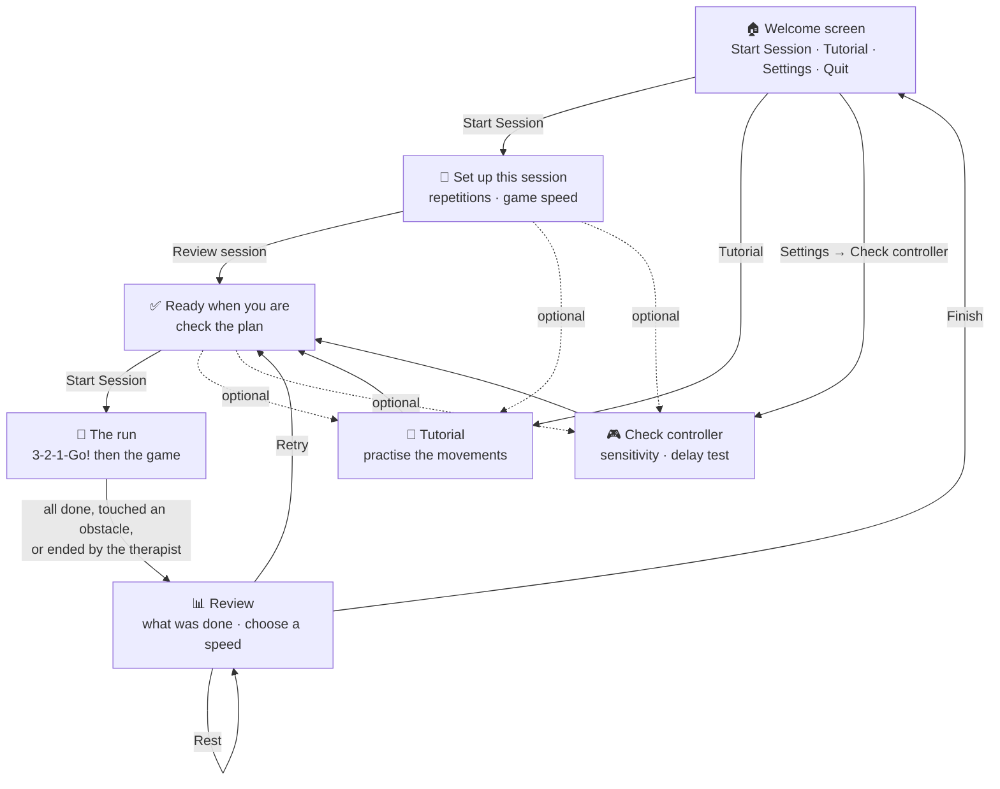
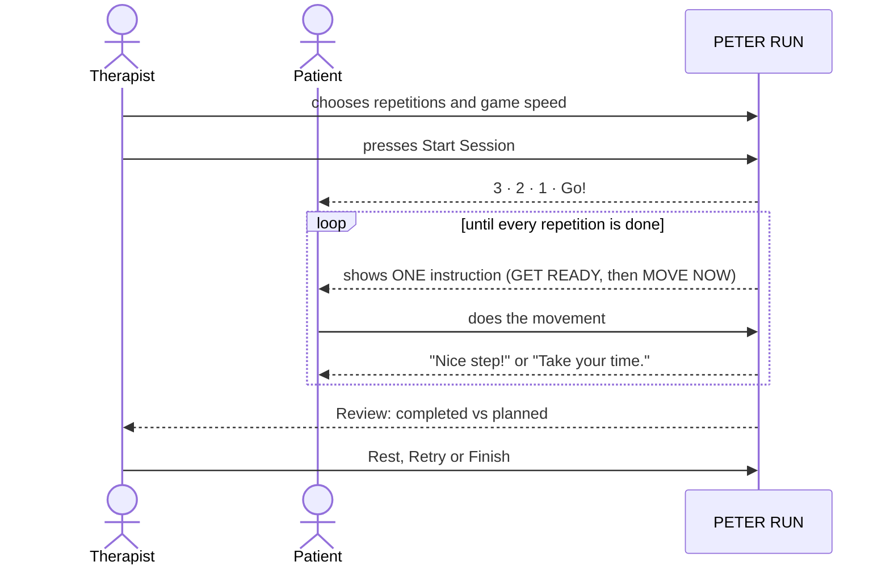
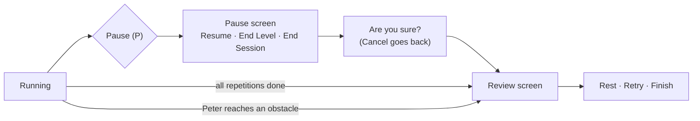
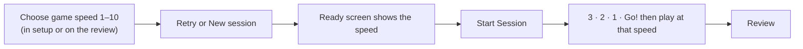

# 4 · How a session flows

> 🗺️ This page shows the whole journey of one session, from opening the game to finishing. Each box is a screen you can see.

## 🧭 The screens and how you move between them

> 💡 Menus are used with the **mouse**. The movement keys only work inside the run.

## 🧑‍🤝‍🧑 Who does what

## ⏯️ Ways a run can end

## 🔁 Retry and the game speed

