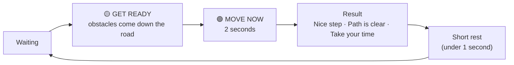
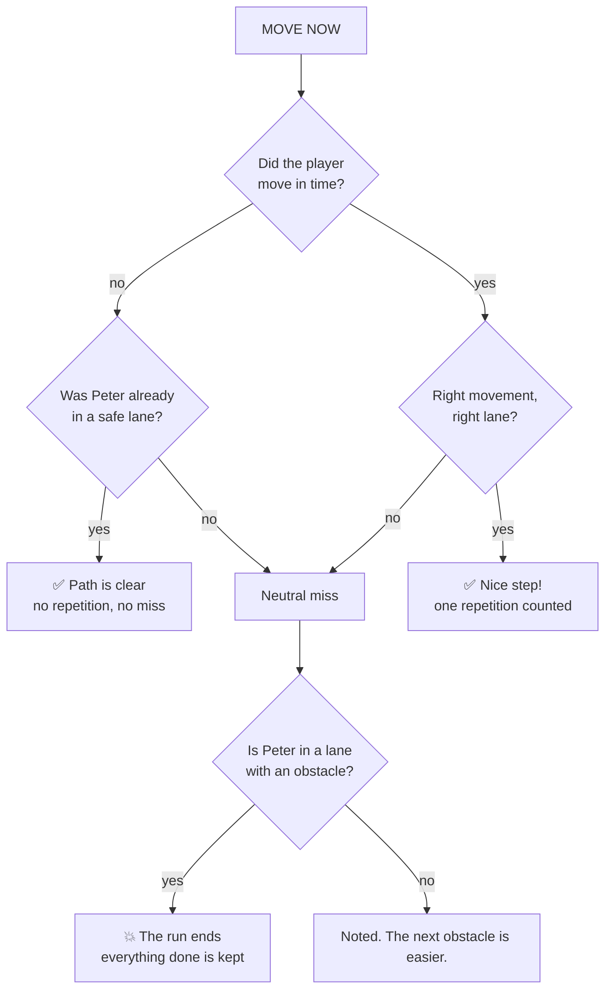
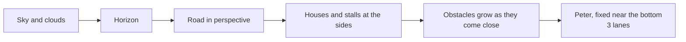

# 5 · How the game works

> 🎮 This page explains the rules inside a run. For the screens, see [How a session flows](4-how-a-session-flows.md).

## 🧍 One run in plain words

1. The therapist sets how many repetitions of each movement.
2. Peter is on one of three lanes. The street moves toward him.
3. The game shows **one** instruction and obstacles that match it. First **GET READY**, then **MOVE NOW** (2 seconds).
4. The player does the movement. If it is the right movement and Peter ends in the right lane, it counts as a **repetition**.
5. If not, it is a **neutral miss**: no penalty, and the next obstacle is easier.
6. If Peter is left in a lane with an obstacle, the run ends and everything done is kept.
7. After a short rest the next instruction comes, until every repetition is done or the therapist stops.

## ⏱️ One instruction, step by step

| Step | How long | Changes with game speed? |
| --- | --- | --- |
| 🟡 GET READY | 1.5 to 4.0 seconds | **Yes** (see [Game speed](6-game-speed.md)) |
| 🟢 MOVE NOW | **2.0 seconds** | **Never** |
| Short rest | 0.75 seconds | No |

## ✔️ How an answer is judged

| Result | Counts as a repetition? | Any penalty? |
| --- | --- | --- |
| ✅ Nice step! | Yes | No |
| ✅ Path is clear. | No | No |
| Take your time. (neutral miss) | No | No |
| 💥 Reached an obstacle | No | The run ends; completed work is kept |

## 🚧 Which movement fits which obstacle

| Obstacle | The right movement | Peter ends… |
| --- | --- | --- |
| 📦 Crates | Move left or right | one lane over, not in the blocked lane |
| 💧 Puddle | Jump | in a lane where jumping clears it |
| 👕 Laundry line | Slide | in a lane where sliding clears it |

## 🛣️ The street that feels like it goes forward

Nothing in the game is 3D. Peter never walks forward on the screen. The street, houses and obstacles move **toward him**, getting bigger as they come close, so it looks like travelling down a road. Every obstacle starts far up the road and arrives at the same moment, at a steady pace.

## 🛡️ What the game does to stay safe

- Only five actions are accepted: left, right, jump, slide, pause.
- A held key is ignored; the same action cannot repeat for a short moment (see [Controls](7-controls-sensitivity-and-delay.md)).
- Pause freezes everything instantly.
- Ending early carries no penalty.
