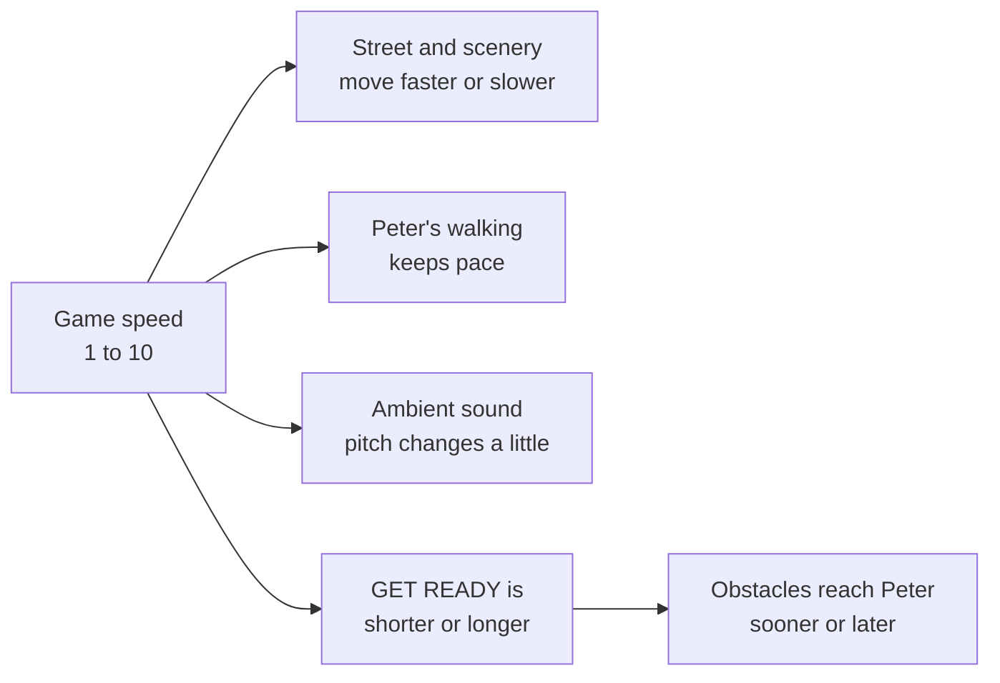

# 6 · Game speed

> 🚀 The game speed is a number from **1 (faster)** to **10 (slower)**. It is chosen in **Session Setup**, and again on the **review screen** for the next run. The screen opens on **6, the standard speed**.

## 🔢 What each number does

| Speed | Street moves at | GET READY lasts | Obstacle takes to reach Peter |
| --- | --- | --- | --- |
| **1** (fastest) | 2.20× | 1.5 s | 3.5 s |
| 2 | 1.96× | 1.7 s | 3.7 s |
| 3 | 1.72× | 1.9 s | 3.9 s |
| 4 | 1.48× | 2.1 s | 4.1 s |
| 5 | 1.24× | 2.3 s | 4.3 s |
| **6** (standard) | **1.00×** | **2.5 s** | **4.5 s** |
| 7 | 0.85× | 2.9 s | 4.9 s |
| 8 | 0.70× | 3.3 s | 5.3 s |
| 9 | 0.55× | 3.6 s | 5.6 s |
| **10** (slowest) | 0.40× | 4.0 s | 6.0 s |

## ✅ What always stays the same

| | |
| --- | --- |
| The time to respond (**MOVE NOW**) | **2 seconds**, at every speed |
| The short rest after an answer | 0.75 seconds |
| The number of repetitions | Set by the therapist |

## 🧩 What a faster speed changes

- Every obstacle starts **far up the road** and moves at **one steady pace** to Peter. It never creeps and then rushes.
- Because the response time is fixed, a faster speed only shortens the **warning** before it.

## 🧪 Why it was built this way

- Real perspective makes a steady object look as if it speeds up near the camera. The game flattens that on purpose so the movement feels calm.
- Starting obstacles nearer to make them slower was tried and removed, because new obstacles then appeared close to Peter.

> ⚠️ **For the therapist:** speeds 1 to 5 give a warning shorter than the original 2.5 seconds (down to 1.5 s at speed 1). Please approve this before patient use. The 2-second response window is never shortened.

## 📝 Tip

If the game feels too hard, lower the **repetitions** or choose a **higher** speed number (slower). If it feels too easy, choose a lower number.
