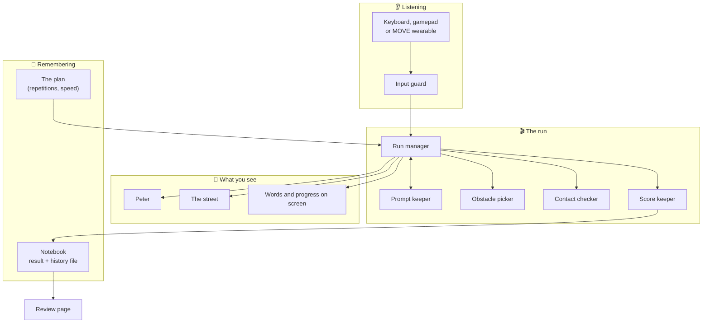
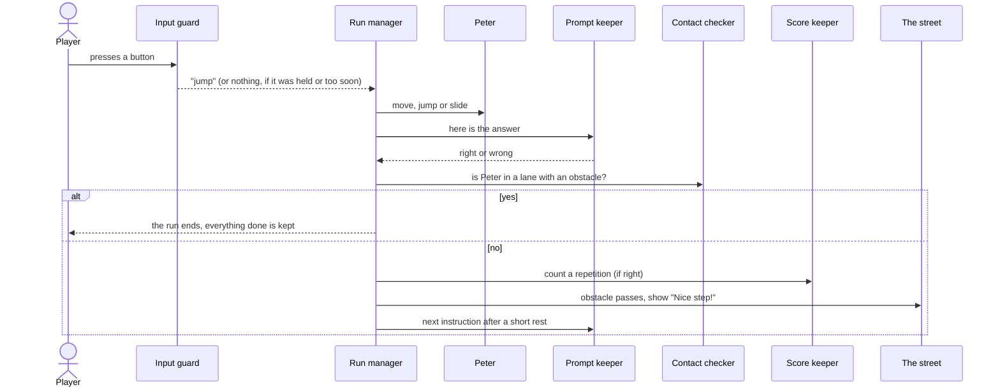
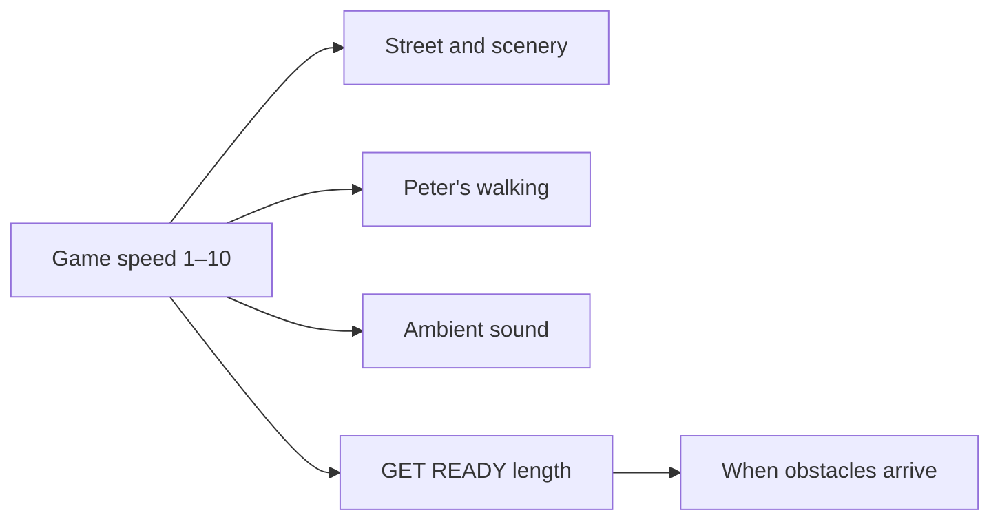

# 8 · How everything connects

> 🧩 No code here. Think of the game as a small team. Each member has one job, and they pass messages to each other.

## 👷 The team

| Member | Its one job |
| --- | --- |
| **The input guard** | Listens to the keyboard or controller, ignores held and repeated presses, and passes on only the five real actions. |
| **The run manager** | The conductor. Starts the countdown, runs the clock, keeps the screen text and ends the run. |
| **The prompt keeper** | Decides what is asked now, and whether the answer was right. |
| **The obstacle picker** | Chooses which arrangement of obstacles comes next, easier ones after a miss. |
| **The contact checker** | Answers one question: "Is Peter in a lane with an obstacle?" |
| **Peter** | Moves, jumps, slides and walks. |
| **The street** | Moves the road, houses and obstacles toward Peter. |
| **The score keeper** | Counts completed repetitions. There are no points. |
| **The review page** | Shows what was done and lets the player pick a speed. |
| **The notebook** | Remembers the plan and the result between screens, and adds a line of numbers to the history file. |

## 🗺️ How they connect

## 🔄 What happens when you press a button

## 🎨 How the speed reaches everything

## 📂 Where things live (for the curious)

| In the game | In the project folder `code/` |
| --- | --- |
| Screens | `scenes/` |
| The team members' behaviour | `scripts/` |
| Levels, colours, obstacle arrangements | `data/` |
| Art and sound | `art/`, `audio/` |
| Checks that the game still works | `tests/` (86 test scripts) |

> 🛠️ Developers: see [How the code works](developers/how-the-code-works.md) and the [code tour](developers/code-tour.md).
