# Guided Code Tour

A step-by-step walk through the PETER RUN code, built to be **led by a presenter** or **followed alone**. Each stop names a file, what to look at, what to say, and a check question. Line numbers are from branch `v8` (2026-10-17) and may drift; the function names are the stable anchors.

> Read [How the Game Works](how-the-game-works.md) first if the game itself is new to you. Terms are in the [Glossary](glossary.md). A condensed reference is in [How the Code Works](how-the-code-works.md).

## Tour plan

| Format | Stops | Time | Audience |
| --- | --- | --- | --- |
| **Express** | 0, 1, 3, 4, 6 | 20 min | Stakeholders, non-programmers |
| **Standard** | 0–7 | 50 min | New developers, reviewers |
| **Deep dive** | 0–9 + exercises | 90 min+ | Anyone about to change the code |

**Setup:** open `code/` in Godot 4 and an editor with the repo. Keep [the diagrams](how-the-game-works.md) on a second screen. Run the game once (F5) so everyone has seen it.

## The map in one picture

```mermaid
flowchart LR
    S0["Stop 0<br/>Rules + project.godot"] --> S1["Stop 1<br/>Scene flow"]
    S1 --> S2["Stop 2<br/>Data: config, level, result"]
    S2 --> S3["Stop 3<br/>Input in"]
    S3 --> S4["Stop 4<br/>Runner loop"]
    S4 --> S5["Stop 5<br/>Prompt Director"]
    S5 --> S6["Stop 6<br/>Collision rule"]
    S6 --> S7["Stop 7<br/>Next prompt choice"]
    S7 --> S8["Stop 8<br/>Visuals"]
    S8 --> S9["Stop 9<br/>Review + tests"]
```



The tour follows the order things happen in a run: **rules → screens → data → input → loop → judging → collision → what comes next → looks → review.**

---

## Stop 0 — Ground rules and entry point (5 min)

**Open:** `code/AGENTS.md` ("Non-negotiable rules"), then `code/project.godot`.

**Look for**
- `run/main_scene="res://scenes/main.tscn"`: where the game starts.
- `[display]`: 480×270 canvas, stretched to 1920×1080.
- `[input]`: the five named actions (`move_left`, `move_right`, `jump`, `slide`, `pause_session`) bound to keyboard **and** gamepad.

**Say:** "Everything the game understands is five named actions. A keyboard, a gamepad and our wearable all end up as the same action. That is why Godot never parses sensor data."

**Check:** Why is there no 3D scene in this project? *(2D with a 2.5D illusion by design.)*

---

## Stop 1 — The screens (5 min)

**Open:** `scripts/main_dashboard.gd`, `ready_screen_controller.gd`, `patient_setup_controller.gd`. Search each for `change_scene_to_file`.

**Look for:** each screen is one scene plus one controller script, and each just calls `get_tree().change_scene_to_file(...)` to move on. There is no central navigation manager.

```text
main → patient_setup → ready → runner_level → session_summary → (ready | main)
         ↘ controller_check / tutorial are optional side trips
```

**Say:** "To change the flow, change the target path in one script."

**Check:** Where does *Retry* send you? *(`session_summary_controller.gd` → `retry_session()` → `ready.tscn`.)*

---

## Stop 2 — The data (5–8 min)

**Open, in this order:**
1. `scripts/session_config.gd` — the **plan**: route id (an inert `affected_side` field remains), `target_repetitions` per action (default 10).
2. `scripts/session_result.gd` — the **outcome**: `completed_repetitions`, `neutral_misses`, `route_seed`, `rpe`. Note `has_met_targets()` and `set_rpe()` (only 1–10).
3. `scripts/level_definition.gd` — a Godot `Resource` with colours, props, timings (`warning_seconds 2.5`, `response_seconds 2.0`, `resolved_seconds 0.75`) and `show_in_setup`.
4. `data/levels/l01_barangay.tres` and `catalog.tres` — real data using that class.
5. `scripts/session_setup_store.gd` and `session_review_store.gd` — two tiny static "mailboxes" that carry the config into the run and the result out of it.

**Say:** "Config goes in, result comes out, level data describes the route. None of these classes draw anything."

**Check:** Why can a level change colours but not speed? *(Data describes cadence; a theme cannot silently change it. See `level_definition.gd`.)*

---

## Stop 3 — Input: from key to action (5 min)

**Open:** `scripts/input_adapter.gd` (45 lines, read all of it).

**Look for**
- `ACCEPTED_ACTIONS`: the whitelist.
- `accept_action()`: ignores a held key, then applies the 0.35 s cooldown.
- `_map_affected_side()`: returns the action unchanged on purpose.

**Say:** "This file is the safety filter between a wearable and the game. One press equals one action."

**Then open:** `tests/input_adapter_test.gd` to show how small a deterministic test can be.

**Check:** What happens if a wearable sends the same key twice within 0.3 s? *(The second is ignored.)*

---

## Stop 4 — The runner: the heart of the game (10–15 min)

**Open:** `scripts/runner_level_controller.gd` (≈740 lines). Do not read it all. Visit these anchors:

| Anchor | ~Line | What to point out |
| --- | --- | --- |
| `_ready()` | 97 | Loads the config, builds `InputAdapter`, loads and **duplicates** the level, picks a random `route_seed`, then either runs the 3-2-1-Go! countdown (when `GameSettings.start_countdown_pending` was set by the Ready screen) or calls `_start_run()` → `_schedule_next_prompt()` |
| `_input()` | 205 | Handles all five actions and marks the event handled so a focused button can't turn the D-pad into menu movement |
| `receive_input()` | 218 | Adapter → pause toggle → ignore if paused/ended → `player.handle_action()` → either store a pending response or call the director |
| Timers | 624–680 | `warning_timer` → open window; `response_timer` → judge; `resolve_timer` → next |
| `_on_prompt_state_changed()` | 329 | One `match` over the director's states: this is where the UI, props, collision and counting all hook in |
| `_record_prompt_resolution()` | 583 | Updates `SessionResult`, toast, effects, and the recovery preference after a miss |

**Say:** "This file orchestrates; it doesn't decide. The *decisions* live in small classes it calls."

**Check:** What stops the player from cheating a formation by pressing early? *(Formation responses are stored as pending and judged at the contact line; the latest accepted action wins.)*

---

## Stop 5 — The Prompt Director (5–8 min)

**Open:** `scripts/prompt_director.gd` (~125 lines).

**Look for**
- `enum State { IDLE, WARNING, ACTIVE, RESOLVED }` and `enum Resolution { NONE, SUCCESS, NEUTRAL_MISS, SAFE_CLEAR }`.
- `schedule()` → WARNING; `open_response_window()` → ACTIVE; `receive_action()` / `expire_active_prompt()` → RESOLVED; `clear_resolved_prompt()` → IDLE.
- `_is_spatially_correct()` at the end: the lane rules for move, jump and slide.

**Say:** "No timers, no art, no collision. Just a state machine and one question: was this answer right?"

**Draw it:** `IDLE → WARNING → ACTIVE → RESOLVED → IDLE`.

**Check:** Which lane makes `move_left` correct? *(`prompt_lane_index − 1`, clamped to 0–2.)*

---

## Stop 6 — The collision rule (3 min)

**Open:** `scripts/formation_collision_resolver.gd` (19 lines, read all of it).

**Look for:** `player_hits_formation()` returns `false` for SUCCESS and SAFE_CLEAR. Otherwise it returns `true` only if an obstacle sits in Peter's final lane.

**Then go back to** `runner_level_controller.gd`, `_on_prompt_state_changed` → `RESOLVED`, and find `_show_collision_end_overlay()` (~line 795) → `_show_neutral_end_overlay(..., &"collision")`.

**Say:** "This single function is the rule 'contact ends the run'. It is deliberate: the product owner confirmed it on 2026-09-27. Do not turn it into lives or score loss."

**Check:** Can a correct answer ever collide? *(No.)*

---

## Stop 7 — What comes next: choosing formations (5 min)

**Open:** `scripts/pattern_library_resolver.gd`, function `select_next_for_targets()` (~line 41), and `scripts/pattern_definition.gd`.

**Look for**
- Candidates must be **reachable** from Peter's current lane.
- Prefer formations whose action still has **remaining repetitions**.
- After a neutral miss, prefer a **recovery** formation (one formation only).
- Seeded by `route_seed`, and `_apply_gentle_pacing()` avoids harsh repeats.

**Then:** `runner_level_controller._schedule_next_prompt()` (~line 264). Show the three sources in order: formation library → legacy pattern sets → legacy planned sequence.

**Say:** "Content is data. Adding a formation doesn't touch the loop."

**Check:** Why can't a run get stuck needing an action that no formation provides? *(An empty result shows a "Route needs review" overlay instead of hanging.)*

---

## Stop 8 — The looks: the 2.5D illusion (5 min, optional for Express)

**Open (skim only):** `world_motion_controller.gd`, `road_projection.gd`, `l01_road_presentation.gd`, `l01_passing_street.gd`, `route_journey.gd`.

**Say:** "Peter never moves forward. The world moves toward him. These scripts only decide *how it looks*; they never decide *whether the answer was right*."

**Show:** the director's state changes call `world_motion.begin_prompt_approach(...)` and `resolve_prompt_approach(...)`; that is the only link between logic and visuals.

**Check:** If you replace the art entirely, which files must stay unchanged? *(The logic classes in Stops 2, 3, 5, 6, 7.)*

---

## Stop 9 — Ending, review and tests (5 min)

**Open:** `runner_level_controller._show_neutral_end_overlay()` (~line 769). It calls `SessionReviewStore.capture(...)` (~line 787); `open_summary()` (~line 655) then changes to `session_summary.tscn`. Next, `session_summary_controller.gd`: `retry_session()` requires a recorded RPE.

**Then tests:** open `tests/prompt_director_test.gd`, `formation_collision_resolver_test.gd`, `input_adapter_test.gd`. Run one:

```text
godot --headless --path code -s res://tests/formation_collision_resolver_test.gd
```

**Say:** "The logic classes are small and pure, so each has a tiny deterministic test. We write the test first, see it fail, then fix."

**Check:** Where would you add a test for 'Retry needs a rating'? *(A summary controller test; see `session_setup_flow_test.gd` for the style.)*

---

## Hands-on exercises

Each exercise changes one thing and teaches one idea. Do them on a scratch branch.

| # | Exercise | You learn | Files |
| --- | --- | --- | --- |
| 1 | Change the warning time to 3.5 s in L01 and run | Levels are data | `data/levels/l01_barangay.tres` |
| 2 | Log every accepted action in `receive_input()` | The input path | `runner_level_controller.gd` |
| 3 | Make `move_left` correct in the same lane (then undo) | How `_is_spatially_correct` drives results; run `prompt_director_test` and watch it fail | `prompt_director.gd` |
| 4 | Add a test: a SAFE_CLEAR never collides | Test-first discipline | `tests/formation_collision_resolver_test.gd` |
| 5 | Add a hidden test route by copying L03's resource | The catalog and `show_in_setup` | `data/levels/` |
| 6 | Change the start countdown to 5 seconds in Settings, then start a run | Settings drive the runner through `GameSettings` | `main_dashboard.gd`, `game_settings.gd`, `runner_level_controller.gd` |

## Cheat sheet for presenters

- **Where is the loop?** `runner_level_controller.gd`
- **Where is the judging?** `prompt_director.gd`
- **Where is the collision rule?** `formation_collision_resolver.gd`
- **Where does input come in?** `input_adapter.gd`
- **Where is content?** `data/levels/*.tres`, `pattern_*.gd`
- **Where are the looks?** `world_motion_controller.gd`, `l01_*`, `road_projection.gd`
- **Where are the results?** `session_result.gd` → `session_review_store.gd` → `session_summary_controller.gd`

## Known rough edges (be honest on the tour)

- `runner_level_controller.gd` is large (about 740 lines) and mixes orchestration, HUD and overlays.
- Two **legacy prompt sources** (pattern sets, planned sequence) remain beside the formation library.
- A comment in `pattern_definition.gd` still mentions "legacy action/lane bridge until PR-14C".
- Settings and review data live in memory only (static stores). Nothing is written to disk.
- Older product documents still describe misses as neutral; the code ends the run on contact.
