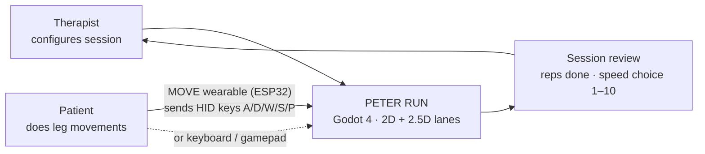
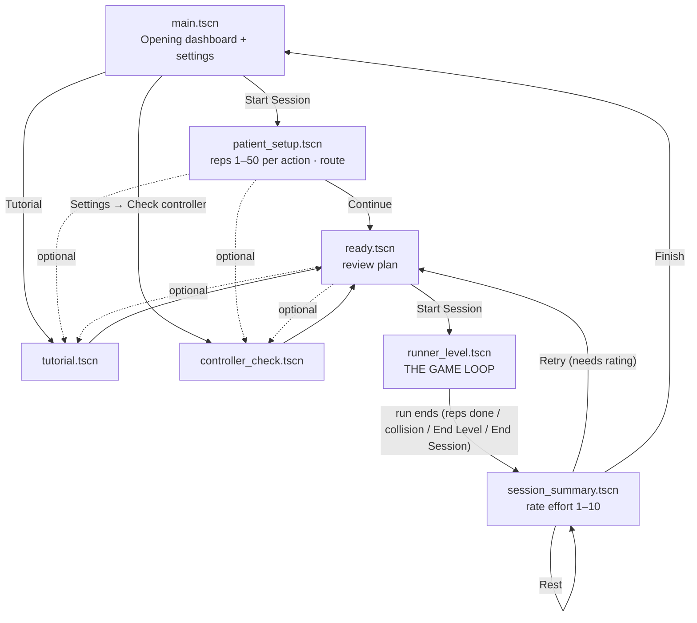
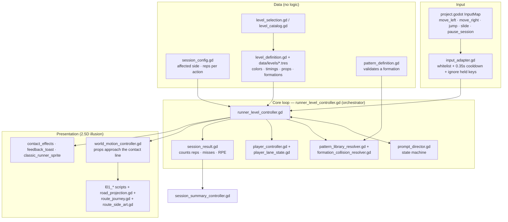
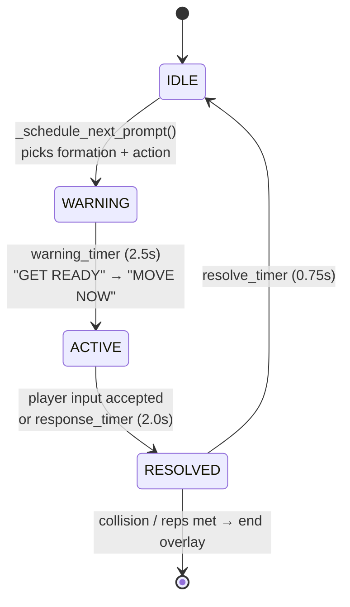
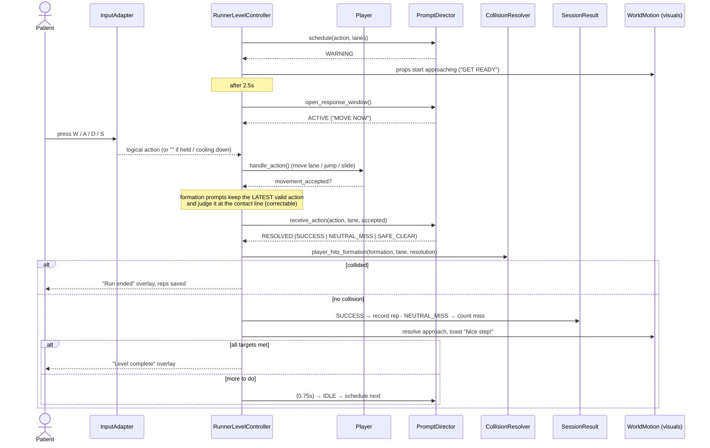
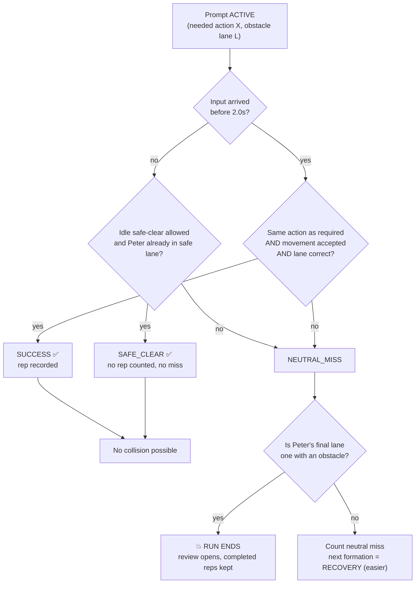
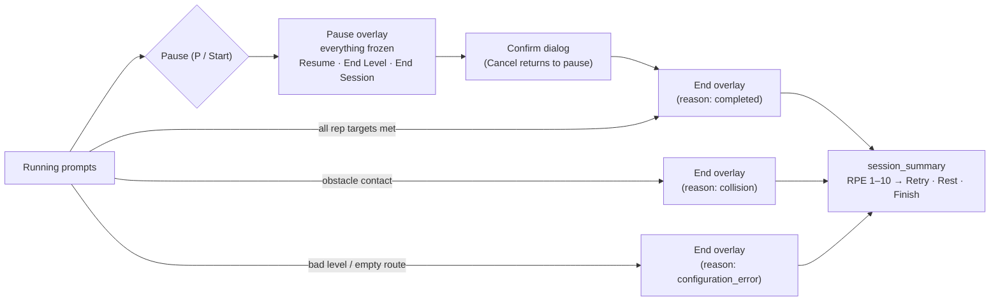
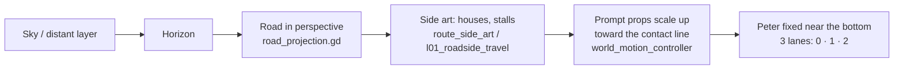

# How the Game Works

## One run in plain words

1. The therapist sets the plan: how many repetitions of each movement.
2. Peter stands near the bottom of the screen on one of three lanes. The street moves toward him.
3. The game shows **one** instruction and obstacles that match it. First *GET READY* (about 2½ s at standard speed; 1½ s at game speed 1 up to 4 s at speed 10), then *MOVE NOW* (about 2 s).
4. The player does the movement. If it is the right movement and Peter ends in the right lane, it counts as a repetition.
5. If not, it is a *neutral miss*: no penalty, and the next obstacle is easier. If Peter is left in a lane with an obstacle, the run ends and everything done is kept.
6. After a short settle (under 1 s), the next instruction comes. This repeats until every repetition target is met, or the therapist ends the session.
7. The player chooses the game speed for the next run (1 = faster, 10 = slower; also set in Setup), then the therapist chooses Rest, Retry or Finish.

The diagrams below show the same thing in more detail. For the code behind it, see [How the Code Works](how-the-code-works.md) and the [Glossary](glossary.md).

---

> Mermaid diagrams: they render in GitHub, VS Code (Markdown Preview Mermaid Support), and Obsidian.
> Source of truth: `code/scripts/*.gd`. Updated for the v18 build, 2026-10-26. The speed model is explained in [Game Speed](game-speed.md).

---

## 1. What the game is (one picture)

**Rules that never change:** fixed response window of 2.0 s (difficulty = repetition count; game speed only changes the GET READY warning and the scenery) · one prompt at a time · Left/Right are literal · **obstacle contact ends the run** · no lives, score loss, chase or shaming.

---

## 2. Screen flow (scene to scene)

Shared state between scenes lives in static stores: `session_setup_store.gd` (the `SessionConfig`), `session_review_store.gd` (the `SessionResult` and the review decision).

---

## 3. Code architecture

**Division of labour**
| Piece | Owns | Does *not* know about |
| --- | --- | --- |
| `input_adapter` | which actions are valid, debounce | what the game wants |
| `prompt_director` | WARNING → ACTIVE → RESOLVED → IDLE and whether the answer was correct | timers, art, collisions |
| `runner_level_controller` | timers, wiring, HUD, end/pause flow | art details |
| `formation_collision_resolver` | "is the player in an obstacle lane?" | everything else (19 lines, pure) |
| `world_motion_controller` + `l01_*` | how it *looks* | whether the answer was right |
| `session_result` | counts | UI |

---

## 4. The heart of the game: one prompt cycle

Per level timing (defaults in `level_definition.gd`): **warning 2.5 s → response 2.0 s → resolved 0.75 s ≈ 5.25 s per prompt.**

### Sequence — what happens between a keypress and the next prompt

---

## 5. Decision logic: how a response is judged

**Lane rules (`prompt_director._is_spatially_correct`)**
| Action | Counts as correct when Peter ends in… |
| --- | --- |
| `move_left` | lane `prompt_lane − 1` (clamped 0–2) |
| `move_right` | lane `prompt_lane + 1` (clamped 0–2) |
| `jump` / `slide` | one of the formation's allowed `action_lanes` (or the prompt lane) |

**Prop → action:** crate = move · puddle = jump · laundry line = slide (each has a distinct silhouette, per the one-prompt-at-a-time rule).

---

## 6. Session lifecycle & ending a run

---

## 7. The 2.5D illusion (what the player *sees*)

Nothing is 3D: Peter never moves forward; the world moves *toward* him. Level look (colors, props, timings) comes from `data/levels/l01_barangay.tres`, `l02_market.tres`, `l03_rainy_crossing.tres` (hidden routes stay in the catalog via `show_in_setup = false`).

---

## 8. Test map (how it's protected)

| Area | Examples in `code/tests/` |
| --- | --- |
| Input safety | `input_adapter_test`, `keyboard_gameplay_input_test`, `controller_safety_test` |
| Prompt/collision logic | `formation_collision_resolver_test`, `formation_runner_test`, `contact_response_test` |
| Flow | `session_setup_flow_test`, `guided_tutorial_test`, `controller_check_interaction_test` |
| Visuals | `l01_*` route tests, `classic_*` sprite/animation tests |

Run all-rules check: `godot --headless --path code -s res://tests/project_setup_smoke.gd`.

---

## 9. Status & planned work

**Done (v19):** full flow menu → setup → ready → moving 3-2-1 countdown → L01 → summary; formation-based prompts; contact-ends-run; game speed 1–10 (scenery, stride, GET READY warning); up to 50 reps per movement; local session history file; tutorial; controller check with a Sensitivity setting and a delay test; 86 Godot test scripts green.

**Open / to plan**
1. **Docs drift:** BRD, PRD and the originality docs still say misses are neutral. Update them to "contact ends the run" (no code change).
2. **Clinical sign-off** for the collision rule is not recorded.
3. **Art in progress (uncommitted):** L01 v04–v08 image sets, Blender 3D adaptation, classic character compositor. Needs an approved final set and a provenance entry before it ships.
4. **Hardware:** validate the MOVE controller (`controller_firmware/`) end-to-end as HID keys.
5. **More routes:** only L01 is offered in setup; L02/L03 exist but are hidden.
6. **Export:** Windows build / Electron wrapper (`electron-peterrun/`) not yet confirmed as the delivery path.
